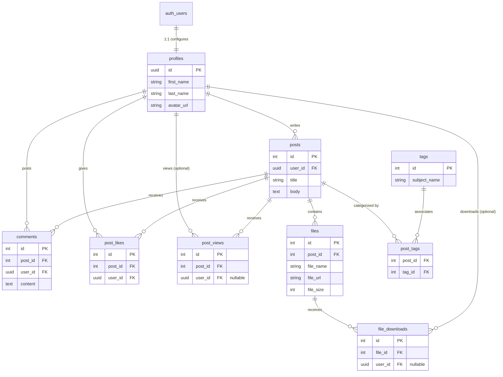

# RuamLem

[](https://github.com/ATOMIC09/RuamLem/actions/workflows/ci.yml)

A full-stack monorepo project designed with modern web technologies. `RuamLem` features a scalable layered backend powered by Bun and ElysiaJS, and a high-performance frontend built with Next.js (App Router) and Tailwind CSS. The data and authentication layers are handled by Supabase.

---

## 🏛 Architecture Overview

The repository is structured as a monorepo containing two main parts:
- **`frontend/`**: The web application client.
- **`backend/`**: The REST API and services backend.

Both applications use **TypeScript** to ensure end-to-end type safety and smooth development context switching.

---

## 🛠 Tech Stack

### Frontend
- **Framework**: [Next.js 15](https://nextjs.org/) (App Router format for optimized server/client rendering)
- **UI & Styling**: React 19, [Tailwind CSS 4](https://tailwindcss.com/)
- **State & Data Fetching**: React Hooks, Axios
- **Build Tool**: Next.js Turbopack
- **Analytics**: Vercel Analytics

### Backend
- **Runtime**: [Bun](https://bun.sh/)
- **Framework**: [ElysiaJS](https://elysiajs.com/) (Fast, type-safe web framework)
- **Database & Auth**: [Supabase](https://supabase.com/)
- **Documentation**: Swagger/OpenAPI (via `@elysiajs/openapi`)
- **Other libraries**: bcrypt (hashing), jsdom

---

## 📂 Project Structure

```text
RuamLem/
├── backend/                  # ElysiaJS Backend
│   ├── src/
│   │   ├── controllers/      # Request handlers & logic endpoints
│   │   ├── routes/           # API Route declarations
│   │   ├── services/         # Core business logic processing
│   │   ├── repositories/     # Data access layer (Supabase interaction)
│   │   ├── ai/               # AI building blocks: Azure client, prompts, SSE, citations, moderation schema, PII rules
│   │   ├── scripts/          # ai:reindex, ai:recheck, ai:moderation-eval
│   │   ├── eval/             # Labelled set and scoring for the moderation eval
│   │   └── utils/            # Shared utilities & middleware (logger, file validation, visibility)
│   ├── sql/                  # Reversible SQL: embeddings, moderation, database hardening
│   └── tests/                # Older manual test scripts (the automated tests live next to the code in src/)
│
└── frontend/                 # Next.js Frontend
    ├── src/
    │   ├── app/              # App Router pages and layouts
    │   ├── components/       # Reusable React components (Navbar, Posts, UI)
    │   ├── hooks/            # Custom React Hooks (e.g., useAuth)
    │   ├── lib/              # Client utilities and helpers (API instances)
    │   ├── services/         # API integration services matching backend domain
    │   └── types/            # TypeScript interfaces & domain types
    └── docs/                 # Documentation (Supabase Analytics info)
```

---

## 🧩 Backend Design

The backend uses a strict **Layered Architecture** to enforce separation of concerns:

1. **Routes (`/routes`)**: Defines the Elysia endpoints and HTTP methods. Directs incoming requests to the appropriate controllers.
2. **Controllers (`/controllers`)**: Validates input data, extracts parameters, coordinates the business flow by calling services, and formats the HTTP responses.
3. **Services (`/services`)**: Contains the core business rules and logic. It calculates, processes, and decides how data should be transformed.
4. **Repositories (`/repositories`)**: Interacts directly with the database (Supabase). This is the only layer that executes queries and mutations against the persistent storage.

### Modules Available
- **Auth**: Authentication and authorization processes.
- **Admin**: Administrative tools and moderation controls.
- **Analytics & Stats**: Data gathering, metrics evaluation, and system statistics.
- **Posts**: Creating, modifying, deleting, and fetching user posts.
- **Profiles**: User profile management and data visualization.
- **Likes & Files**: Interaction mechanisms and media/file uploading endpoints.
- **AI**: Ask RuamLem (RAG with streaming) and AI moderation with a human override. See [AI features](#-ai-features).

---

## 🗄️ Database Design

The data layer uses PostgreSQL (via Supabase) utilizing a relational approach. The database schema has evolved from its initial manual design to a more robust representation bridging application needs with Supabase's ecosystem.

### 🎨 Initial Database Design
The original database architecture was a conceptual draft manually mapped out using dbdiagram.io, serving as the starting layout for features encompassing users, posts, and tags.


### 🛠️ Real Implementation
The live schema expanded upon the initial draft, replacing generic identifiers with Supabase-native ones, accounting for engagement tracking, and optimizing specific entities.



#### Core Entities
- **profiles:** Extends the basic `auth.users` managed by Supabase, storing application-specific details like first name, last name, and avatar configurations.
- **posts:** The main content hub generated by users containing textual content and titles.
- **files:** Handles post attachments storing media/document metadata (URL, file size) pointing to the Supabase Storage Buckets.
- **comments:** Allows conversational data nested under individual post entities.
- **tags / post_tags:** A many-to-many relationship resolving categorization for the content. The frontend dynamically resolves the primary post "category" based on the first associated tag.
- **post_likes, post_views, file_downloads:** Junction tables explicitly tracking granular engagements—not just simple counters on the main table.

### 🔄 Differences

1. **User Table Replaced by Profiles (Supabase Integration)**
   - *Initial Design*: Assumed a generic `users` table with an auto-incrementing integer `id` and a basic `username` field.
   - *Real Implementation*: Delegates core authentication to Supabase's internal `auth.users`. An application-level `profiles` table is now used, tracking a `uuid` representing the logged-in user, along with granular application-specific fields (`first_name`, `last_name`, `avatar_url`, and `bio`).

2. **Expanded Granular Engagement Tracking (Likes, Views, Downloads)**
   - *Initial Design*: Did not specify how users would like posts, view counts, or track engagements.
   - *Real Implementation*: Instead of intrinsic integer counters on the `posts` table, dedicated `post_likes`, `post_views`, and `file_downloads` tables were introduced. This isolates analytics per exact user or anonymous session, offering much higher analytic fidelity.

3. **Dynamic Frontend Categorization**
   - *Initial Design*: Focused purely on basic relational tables mapping posts.
   - *Real Implementation*: Instead of relying purely on a hardcoded "category" string, the backend resolves arrayed entries in `tags` and exposes this for the frontend to compute category abstractions dynamically.

---

## 💻 Frontend Design

The frontend strictly follows Next.js App Router conventions:

- **Routing (`src/app`)**: Route segments organized into logical paths (`/admin`, `/community`, `/profile`, `/signin`, `/signup`, `/post`). Nested routing is used for features like `[id]` (view post) and `[id]/edit` (edit post).
- **Component Design (`src/components`)**: Reusable UI parts are decoupled from the routing. Contains layout shells, `auth-guard` for protected routes, and interaction elements like `post-button` or `searchbox`.
- **API Services (`src/services`)**: Strongly typed Axios wrappers abstracting backend API calls.
- **Authentication Flow**: Supports a robust flow from standard Sign-up/Sign-in to email confirmation, password resets, and forgot-password routines. 

---

## 🤖 AI features

Two small features built on **Azure OpenAI** and **Azure AI Content Safety**, both written in TypeScript and both behind their own kill switch (`AI_ENABLED`, `AI_MODERATION_ENABLED`). With both off, the site behaves exactly as it did before.

### Ask RuamLem: RAG with streaming

A signed-in user opens `/ask` and asks a question in Thai or English. The answer streams in, is built **only from RuamLem posts**, and carries numbered citations (`[1]`, `[2]`) that link to those posts.

1. **Embed** the question with `text-embedding-3-small` (1536 dimensions).
2. **`match_posts`**: cosine search over one embedding per post in Supabase **pgvector**; top 5 above a tuned similarity cutoff (0.43). No match means a fixed "no post found" answer and **the chat model is never called**.
3. **Prompt**: the rules plus the matching posts, numbered and delimited as data (angle brackets in post text are escaped, so a post cannot close its block or give the model orders).
4. **Stream** the answer over Server-Sent Events (`POST /ai/ask`). A streaming filter drops any `[n]` that does not point at a source that was actually sent.

The page (`frontend/src/app/ask`) reads the stream with `fetch`, has a Stop button, and renders the model's text with `SafeMarkdown`: no raw HTML, no images, links only to RuamLem's own `/post/<id>`. Screen readers hear the answer once it is complete, not every token.

### AI moderation with a human override

New posts, edits and comments are checked **before anyone else sees them**. The AI decides nearly everything; a person can always overturn it.

| AI verdict | What happens | Human involvement |
|---|---|---|
| Clean (most posts) | Published at once | None |
| Clearly harmful (severity 6 in hate, sexual, violence or self-harm, or obvious spam) | Rejected; the author sees the reason | Only if the author appeals |
| Borderline (severity 4, personal data, off-topic, unsure, or any check that failed) | Held: hidden from others, shown to the author as "under review", not indexed for Ask RuamLem | An admin approves or rejects in the **Moderation** tab of `/admin` |

How a decision is made:

- **Deterministic checks first, at no cost**: a Thai national ID (13 digits with a valid checksum) or a phone number holds the item without calling any model.
- **Two paid checks run together**: Azure AI Content Safety (harm categories, severity 0, 2, 4 or 6) and the chat model with strict structured output (spam, off-topic, personal data, abuse), validated against the same TypeBox schema that is sent as `response_format`.
- **A pure decision function** turns those results into `published`, `held` or `rejected`. Rejected beats held beats published.
- **It fails safe.** Invalid model output, a timeout, an outage or a rate limit means **held** (`check_failed`), never published. The trade-off: during an outage new posts wait. `bun run ai:recheck` re-runs those items once the checks work again.
- **Humans can always overturn the AI.** An author can appeal an AI rejection; an admin can approve or reject anything in the queue (appealed items first). An admin's rejection is final and cannot be appealed.
- **Everything is auditable.** Every AI decision and every override is a row in `moderation_log` (`ai`, or the user id of the admin or author), so "who removed what" has an answer.
- **Public reads only ever return published content**: lists, pagination, tag filter, a single post, comments, counts and statistics. Authors still see their own held and rejected items with the status. Held and rejected posts are removed from the Ask RuamLem index.
- A file name that contains a phone number or ID number holds its post. File contents are not scanned (out of scope).

### Measured results

`bun run ai:moderation-eval` scores moderation on a labelled set of **81 items**: 49 real posts and comments (read from the database by id, so no user text is stored in the repo or printed) and 32 synthetic ones (24 bad: spam, loan and crypto scams, off-topic ads, a valid and an invalid Thai national ID, phone numbers in three formats, a student name and ID in a file name, Thai insults, a threat, hateful text, sexual spam, self-harm, and two prompt-injection attempts; 8 tricky but normal: course codes, Thai numerals, English, code snippets, a study-group invitation). Run on 14 Oct 2026 against the live deployments.

| | First run | After tightening the off-topic rule |
|---|---|---|
| Normal content published (48) | 47 | **48** |
| Normal content wrongly held / rejected | 1 / 0 | **0 / 0** |
| Bad content caught (24) | 23 | **24** |
| Bad content wrongly published | 1 (a meal-invitation post) | **0** |
| Checks that could not finish | 0 | 0 |
| Latency per item (median / p95) | 1.9 s / 3.0 s | 1.9 s / 2.7 s |

Nine junk test posts and comments from development are not scored (either outcome is fine): 7 were held and 2 rejected.

What the numbers do and do not say:

- **The first run found a real miss.** The off-topic rule said "not about courses, studying, exams or university life", and a meal invitation after class is university life. The rule now names social chat, invitations and selling as off-topic for posts and keeps study-group invitations fine.
- **The thresholds barely matter.** Content Safety reached severity 4 or more on only 3 items and 2 on only 2 more, and the outcome was identical for hold at severity 2, 4 or 6, so the starting thresholds (reject at 6, hold at 4) stay.
- **Thai is where the second check earns its place.** Content Safety scored a Thai threat at severity 4 but a plainly abusive Thai insult only at 2, so insults reach a person only because the model check has an `abuse` rule.
- **It is a small set, tuned on itself, and a model is not deterministic** (a one-word "test" comment was held in one run and published in the next). Treat it as evidence that the pipeline behaves, not as a guarantee. Re-run it after changing a prompt, a threshold or a model.
- **Retrieval** (Ask RuamLem) was checked on 13 Thai questions I wrote from the post titles: the right post was in the top 5 for 7 of 8, and none of the 5 unrelated questions got past the 0.43 cutoff (they topped out at 0.41 while the weakest correct hit scored 0.46). The one miss was a Thai term for "artificial intelligence" against a post titled "AI". The cutoff should be re-checked with real student questions.

### How it stays safe

- **Answers come from the posts only**, and every citation is checked against the sources that were sent.
- **Posts are data, never instructions** in both features. Text is escaped before it is placed in a prompt, and Azure's own jailbreak filter is treated as a final answer: a post that trips it is held for a person instead of being retried on another model.
- **Model output is never put into the page as HTML.** `SafeMarkdown` renders without `rehype-raw`, drops images and keeps only links to `/post/<id>`; it is tested against `<script>`, ``, `javascript:` and `data:` links, markdown images and links to other sites.
- **Nothing sensitive is logged.** Logs hold ids, decisions, rule or category names, token counts and timings, never a question, an answer or a post's text.
- **No AI key reaches the browser.** Every model call goes through the backend.
- **Uploads are checked on the server**: only pdf, doc, docx, ppt, pptx, jpg, jpeg, png and txt, and only when the first bytes match the extension (a renamed `.exe` is rejected). The stored content type comes from the validated type, never from the client.

### Running it

```bash
# backend/.env (see backend/.env.example for every variable)
AI_ENABLED=true                 # Ask RuamLem
AI_MODERATION_ENABLED=true      # moderation
AZURE_OPENAI_ENDPOINT=https://<resource>.openai.azure.com/openai/v1/
AZURE_OPENAI_CHAT_DEPLOYMENT=...      # deployment names, not model names
AZURE_OPENAI_EMBED_DEPLOYMENT=...
AZURE_CONTENT_SAFETY_ENDPOINT=...
SUPABASE_SERVICE_ROLE_KEY=...         # server-side only

# frontend/.env
NEXT_PUBLIC_AI_ENABLED=true
```

```bash
cd backend
# SQL, in order, in the Supabase SQL editor (each file ends with its own rollback):
#   sql/001_ai_embeddings.sql   pgvector table and match_posts()
#   sql/002_moderation.sql      moderation columns on posts and comments, moderation_log
bun run ai:reindex              # index (or re-index) every post; safe to repeat
bun run ai:recheck              # re-run items held because a check failed
bun run ai:moderation-eval      # measure moderation on the labelled set
bun test src                    # backend tests (no network, no secrets)
```

Things to know:

- **Capacity.** The student-subscription chat deployment allows **15 requests per minute**. Each new post, edit or comment and each Ask question costs one chat call, so a burst beyond that is held as `check_failed` (the fail-safe working as designed) and cleared with `ai:recheck`. The in-memory daily question limit is per server instance and resets when it restarts.
- **Thai.** The embedding model supports Thai but is not its strongest language; retrieval and moderation were measured on Thai text (see above) and the cutoffs tuned on that data. If retrieval proves weak, switch to `text-embedding-3-large` with `dimensions: 1536` (same schema) and run `bun run ai:reindex`.
- **Deploying.** Set `SUPABASE_SERVICE_ROLE_KEY` and the Azure variables where the backend runs before turning either switch on.

### Database security

An audit with the Supabase advisor found that row level security was off on most tables and that some policies and storage policies were open to the public role, so anyone holding the public anon key could read and change data and exam files. The backend now uses the service-role key for data and storage (user sign-in and token checks stay on the anon key), and `backend/sql/003_database_hardening.sql` turns RLS on and drops the open policies, so the anon key can reach nothing. The RLS half was tested against the live project (the backend passed 26 of 26 smoke checks while the anon key saw 0 rows on all seven tables) and then rolled back; the policy drops were reviewed but not executed in that test. It is a separate, reversible step: **deploy the backend with `SUPABASE_SERVICE_ROLE_KEY` set first, then run the SQL.** The new code works with or without it.

Recommended but not implemented: keep the session token out of `localStorage` (an httpOnly cookie) so an XSS bug cannot steal it.

---

## 🚀 Getting Started

### Prerequisites
- [Bun](https://bun.sh/) installed locally (used for both frontend and backend).
- A [Supabase](https://supabase.com/) project configured with proper tables and buckets.

### Running Backend
```bash
cd backend
bun install
bun run dev
bun run test   # no network or secrets needed
```

### Running Frontend
```bash
cd frontend
bun install
bun run dev
bun run test
```

---

## 📄 License
This project is properly licensed. See the `LICENSE` files inside the `backend/` and `frontend/` directories for details.

