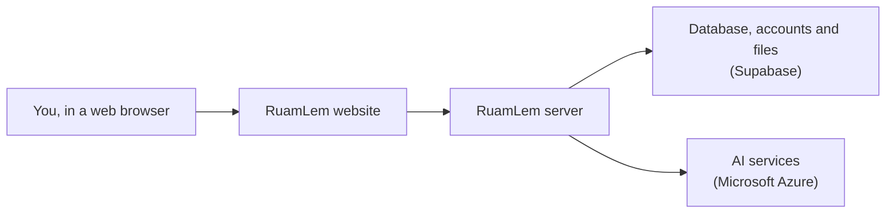

# RuamLem

[](https://github.com/ATOMIC09/RuamLem/actions/workflows/ci.yml)

**RuamLem is a website where university students share course materials and past exam papers with each other.** The name comes from the Thai word รวมเล่ม, a collected volume.

It also has two AI helpers: one is a study chatbot that knows the material on the site, and one checks new posts so the site stays useful and safe, with a person always able to step in.

---

## What you can do

**As a student**

- **Share** exam papers, summaries and slides (PDF, Word, PowerPoint, images or text), tagged with the course they belong to.
- **Find** material on the community page by searching for words, a course, a date or a file type.
- **Chat** with Ask RuamLem in Thai or English. Ask for material, such as "มีข้อสอบ midterm วิชา Signals ไหม", and the answer is built from posts on the site, with links to them. Or ask anything about your studies and get a normal assistant answer.
- **Talk** with others by liking posts and leaving comments.

**As an admin**

- See statistics, the most popular posts and every member.
- Remove posts, remove members, or make someone an admin.
- Review the posts the AI was unsure about, and publish or reject them.
- See how much the AI is used: who, how many tokens, and an estimated cost.

## The two AI helpers

### Ask RuamLem

A chat where the answer appears word by word, and follow-up questions work. It has two modes. When posts on RuamLem match your message, the answer is written **only from those posts**, and every statement has a small number like `[1]` that links to the post it came from. When nothing matches (a greeting, a concept to explain, study advice), it answers like a normal assistant and labels the answer as general, so you know it is not from RuamLem's posts. It is never allowed to invent posts or links.

### Automatic checking, with people in charge

Every new post and comment is checked before anyone else sees it.

| What the AI sees | What happens |
|---|---|
| A normal post (most of them) | It appears straight away |
| Something clearly harmful, or an obvious advert | It is rejected and the author is told why. The author can ask an admin to look again. |
| Something it is unsure about, such as a phone number, an off-topic post or rude language | It waits for an admin. Only the author can see it in the meantime. |

Every decision, by the AI or by a person, is recorded, so it is always possible to see who decided what. The AI can be switched off at any time, and the site then works exactly as it did before.

## How it fits together



The website only ever talks to the RuamLem server. The server holds every password and key, stores data and files in Supabase, and asks Azure's AI services for answers and checks.

## Is it safe?

- Passwords and keys never reach your browser.
- Uploaded files are checked on the server, so a program disguised as a PDF is refused.
- Answers from the AI can never run code in your browser, and they only link to RuamLem's own posts.
- Phone numbers and ID numbers in posts are held back for a person to review.
- The server holds **no all-powerful database key**. Every request runs as the person who sent it, and the database itself decides, row by row, what that person can see or change (row level security is on for every table).
- The old open database rules were closed and tested against the database directly with real tokens (77 checks). The details are in [docs/security.md](docs/security.md).

## Run it on your own computer

You need [Bun](https://bun.sh/) and a [Supabase](https://supabase.com/) project.

```bash
cd backend && bun install && bun run dev     # the server, on http://localhost:3030
cd frontend && bun install && bun run dev    # the website, on http://localhost:3000
```

Both folders have a `.env.example` file listing the settings to fill in. The full guide, including the AI features, is in [docs/development.md](docs/development.md).

## Learn more

| If you want to know... | Read |
|---|---|
| How the pieces fit together | [Architecture](docs/architecture.md) |
| What is stored, and where | [Database](docs/database.md) |
| Every server endpoint | [API reference](docs/api.md) |
| How Ask RuamLem finds and writes answers | [Ask RuamLem](docs/ask-ruamlem.md) |
| How posts are checked, appeals, and how accurate it is | [AI moderation](docs/moderation.md) |
| What keeps users and data safe | [Security](docs/security.md) |
| How to set up, test, deploy and fix problems | [Development and operations](docs/development.md) |

Start with the [documentation index](docs/README.md) if you are new.

## Built with

- **Website:** Next.js 15, React 19, Tailwind CSS 4, hosted on Vercel
- **Server:** Bun and ElysiaJS in TypeScript, hosted on Render
- **Data, accounts and files:** Supabase (Postgres with pgvector)
- **AI:** Azure OpenAI and Azure AI Content Safety
- **Checks:** automated tests and GitHub Actions on every change

## License

See the `LICENSE` files in `backend/` and `frontend/`.
