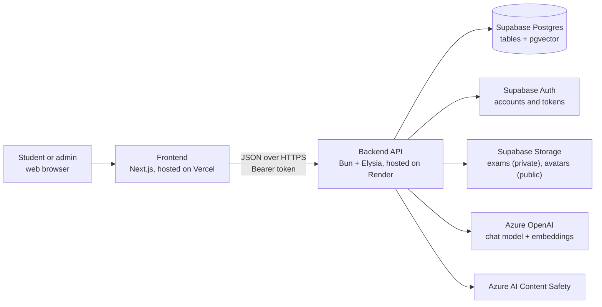
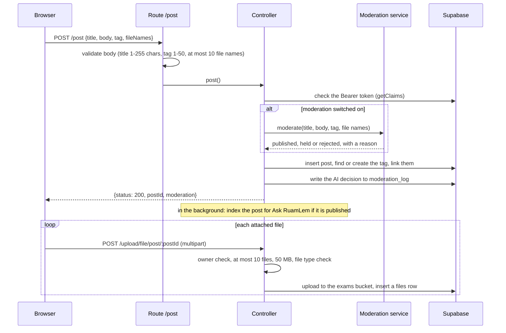
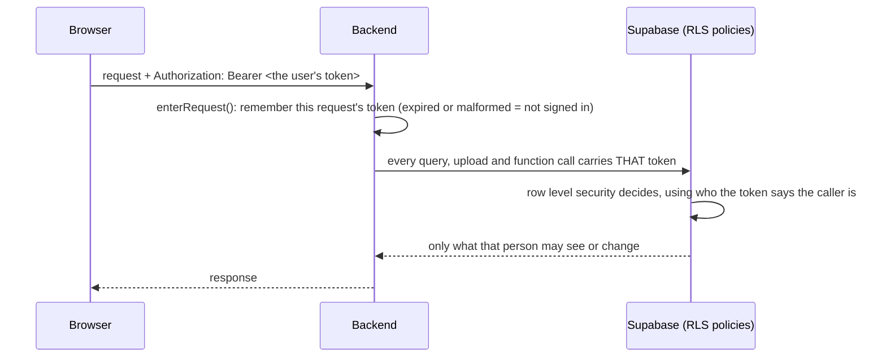
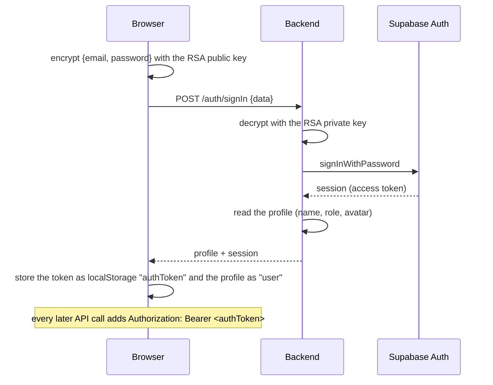

# Architecture

This page describes the parts of RuamLem, where each one runs, and how they talk to each other.

## The big picture



The browser only ever calls the backend. It never holds a database key or an AI key. The two exceptions are file downloads: avatars load from Supabase's public URL, and exam files download through a short-lived signed URL (60 seconds) that the backend creates.

## Where each piece runs

| Piece | Technology | Hosted on | Notes |
|---|---|---|---|
| Frontend | Next.js 15 (App Router), React 19, Tailwind CSS 4, Axios | Vercel | Vercel Analytics is enabled. |
| Backend | Bun 1.3, ElysiaJS 1.4, TypeScript | Render (Docker image built from `backend/Dockerfile`) | Listens on port **3030** (fixed in `src/index.ts`). Interactive API docs at `/openapi`. |
| Database | Supabase Postgres with the `vector` extension | Supabase | Schema in [database.md](database.md). |
| Accounts | Supabase Auth (email and password, email confirmation) | Supabase | |
| Files | Supabase Storage | Supabase | `exams` bucket is private, `avatars` is public. |
| Language model | Azure OpenAI, v1 endpoint, a chat deployment | Azure | The deployment name is configured, not hard-coded. |
| Embeddings | Azure OpenAI, `text-embedding-3-small` deployment, 1536 dimensions | Azure | |
| Content screening | Azure AI Content Safety, text analysis | Azure | Used by moderation only. |

## Repository layout

```text
RuamLem/
├── README.md                     Short overview for everyone
├── docs/                         These pages
├── .github/workflows/ci.yml      Tests and builds on every push and pull request
├── backend/
│   ├── Dockerfile                Image used on Render
│   ├── sql/                      Database changes, in order, each with its own undo section
│   ├── tests/                    Older manual test scripts (not run by CI)
│   └── src/
│       ├── index.ts              Starts the server, CORS, OpenAPI, registers every route
│       ├── request-context.ts    Keeps each request's token so every database call runs as that person
│       ├── supabase.ts           The two Supabase clients (per-request data client, auth client), see below
│       ├── ops/                  The privileged client, imported ONLY by the operator scripts
│       ├── routes/               HTTP paths, request validation
│       ├── controllers/          Reads the token, calls services and repositories, shapes responses
│       ├── services/             Business rules
│       │   └── ai/               Ask RuamLem and moderation logic
│       ├── repositories/         The only code that queries Supabase
│       ├── ai/                   AI building blocks: Azure client, prompts, SSE, citations,
│       │                         moderation schema, personal-data rules, Content Safety client
│       ├── utils/                Logger, file-type validation, "who may see this" rules
│       ├── scripts/              ai:reindex, ai:recheck, ai:moderation-eval
│       └── eval/                 Labelled data and scoring for the moderation eval
└── frontend/
    ├── docs/                     Older setup notes (analytics tables)
    └── src/
        ├── app/                  Pages (one folder per URL), shared components and hooks
        │   ├── components/ai/          Ask RuamLem components
        │   └── components/moderation/  Status badge, notice with appeal button, admin queue
        ├── services/             One file per backend area (posts, auth, admin, ...)
        ├── lib/                  API client, encryption, SSE parser, feature flags, moderation labels
        └── types/                Shared TypeScript types
```

Automated tests live next to the code they test (`*.test.ts`, `*.test.tsx`).

## Backend

### Four layers

Every feature follows the same path through four layers. Each layer has one job.

| Layer | Folder | Job |
|---|---|---|
| Route | `src/routes/` | Declares the HTTP method and path, and validates the request body with Elysia's `t` (TypeBox). An invalid body is rejected with HTTP 422 before any code runs. |
| Controller | `src/controllers/` | Reads the `Authorization` header, checks the token, calls services and repositories, and builds the response. |
| Service | `src/services/` | Business rules that are not about storage: password rules, the moderation decision, the Ask flow. |
| Repository | `src/repositories/` | The only place that queries Supabase. |

The AI code adds one more folder, `src/ai/`, for building blocks that talk to Azure (the OpenAI client, the Content Safety client) or that are pure helpers (prompts, the SSE encoder, the citation filter).

### Example: what happens when a student creates a post



### Conventions every endpoint follows

- **CORS** allows only the address in `FRONTEND_URL`.
- **Signed-in requests** send `Authorization: Bearer <Supabase access token>`. The controller checks it with Supabase (`getClaims`) and uses the token's `sub` as the user id.
- **Admin requests** also check that the user's `profiles.user_role` is `admin`.
- **Response shape.** Most endpoints answer with HTTP 200 and put the outcome in the JSON body (`status`, `success`, `error`, `message`). The frontend's `apiRequest` treats a body `status` of 401 or 500 as an error. The Ask endpoint is different: it uses real HTTP status codes (401, 422) and streams its answer.
- **Logging** goes to the console. The AI code logs ids, decisions, rule names, token counts and timings, and never the text of a question, an answer or a post.

### Every request runs as its caller

The server does **not** hold a key that bypasses the database's protections. Each request is handled like this:



- `src/request-context.ts` keeps the token in a per-request store (`AsyncLocalStorage`), so two requests can never see each other's token. A test fires 40 interleaved requests and checks this.
- `src/supabase.ts` exports `supabase`, a thin stand-in that, on each use, picks the current request's client. Repositories keep writing `supabase.from("posts")...` and now automatically act as the caller. A request with no usable token acts as `anon`.
- `supabaseAuth` is a separate client with only the public anon key, for people who may not be signed in yet: sign-up, sign-in, checking a token, password reset.
- A few things used to need the powerful key. They now use narrow database functions that check the caller (`admin_list_users`, `record_post_view`, ...). See [security.md](security.md).

**The service-role key** exists only for three maintenance scripts (`ai:reindex`, `ai:recheck`, `ai:moderation-eval`), which have no signed-in user. It is read in one file, `src/ops/privileged-client.ts`, which only the scripts import. It must never be set on the production server, and tests fail if any server file mentions it.

### Kill switches

| Variable | Where | When `false` |
|---|---|---|
| `AI_ENABLED` | backend | `/ai/ask` answers "AI disabled", and posts are not indexed for Ask RuamLem |
| `AI_MODERATION_ENABLED` | backend | New posts and comments are published at once and nothing is screened. Items that were already held or rejected stay hidden: the database keeps enforcing that. |
| `NEXT_PUBLIC_AI_ENABLED` | frontend | The `/ask` page and its navbar link do not exist |

The moderation UI (status badges, appeal buttons, the admin tab) needs no switch of its own: it only appears when the backend sends moderation data.

## Accounts and sign-in



- **Sign-up** works the same way: the browser encrypts `{email, firstName, lastName, password}` and sends it to `POST /auth/signUp`. The backend checks the password (at least 8 characters, with at least one letter and one digit), creates the Supabase account with an email confirmation link to `/confirm-email`, and creates a `profiles` row with the role `member`. If the profile cannot be created, the account is deleted again.
- **Why encrypt in the browser?** The credentials are encrypted with RSA-OAEP before they leave the page. It is an extra layer on top of HTTPS, not a replacement for it. The key pair lives in `RSA_PRIVATE_KEY` (backend) and `NEXT_PUBLIC_RSA_PUBLIC_KEY` (frontend).
- **Password reset** sends an email (`POST /auth/forget`) with a link to `/reset-password`. That page checks the link (`/auth/verify-reset-token`) and then sets the new password (`/auth/reset-password`).
- **Roles** are stored in `profiles.user_role`: `admin`, `member` or `guest`. Admins can change a user's role from the admin page.
- **Where the token lives.** The access token is kept in `localStorage`. That is simple but readable by any script on the page, which is why safe rendering of AI output matters (see [security.md](security.md)).

## Frontend

### Pages

| URL | What it does |
|---|---|
| `/` | Home: the latest posts and the three posts with the most comments |
| `/community` | All posts with search: text, tag, date range and file type filters, plus sorting. It loads the latest 100 posts and filters them in the browser. Filters are kept in the URL. |
| `/post` | Create a post: title, description, exactly one tag, and 1 to 10 files of up to 50 MB each |
| `/post/[id]` | A post: its files (download), likes, views, comments and sharing. The author sees a status notice if the post is held or rejected. |
| `/my-posts` | Your own posts (matched by your user id) with their moderation status, and buttons to edit, delete or appeal |
| `/my-posts/[id]/edit` | Edit a post and add or remove files |
| `/ask` | Ask RuamLem, a chat that answers from posts or general knowledge (only when `NEXT_PUBLIC_AI_ENABLED=true`) |
| `/profile` | Edit your name, bio and avatar |
| `/admin` | Admin dashboard: statistics, top posts, members, posts, and a **Moderation** tab when moderation is on |
| `/signin`, `/signup`, `/confirm-email`, `/forgot-password`, `/reset-password`, `/terms` | Account pages and terms |

### How the frontend code is organised

| Folder | Contents |
|---|---|
| `src/app/` | One folder per page, plus `layout.tsx` (fonts, navbar, analytics) |
| `src/app/components/` | Shared components: navbar, post card (`previewpost.tsx`), search box, Ask RuamLem components, moderation components |
| `src/app/hooks/` | `use-auth` (who is signed in, read from `localStorage`) and `use-ask` (the Ask RuamLem state machine) |
| `src/services/` | One file per backend area. Each function calls the backend and returns `{ data }` or `{ error }`. |
| `src/lib/` | `api.ts` (the Axios client that adds the token), `crypto.ts` (RSA encryption), `sse.ts` and `ask-stream.ts` (streaming), `moderation.ts` (status labels and Thai reasons), `features.ts` (feature flags) |
| `src/types/` | Types shared between pages |

The UI is in Thai and uses the Kanit font. Colours come from a small palette (`#1c2a48`, `#405168`, `#5e7593`, `#7a8b99`, `#dee5ed`).
