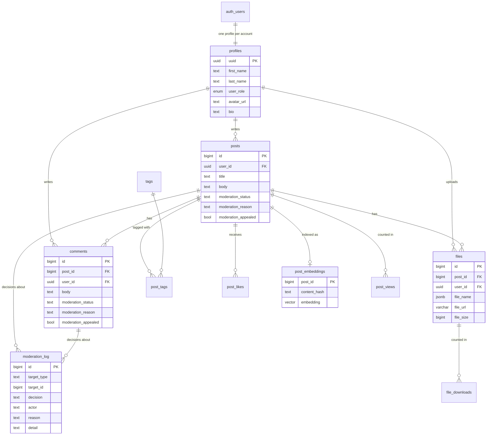

# Database

RuamLem stores everything in a Supabase project: a Postgres database, Supabase Auth for accounts, and Supabase Storage for files. Only the backend talks to it.

## Tables at a glance



The lines between `post_views`, `file_downloads` and `moderation_log` and the other tables are logical links only: those tables have no foreign key.

## Every table

All tables also have `created_at` and most have `updated_at`.

| Table | Columns | What it holds |
|---|---|---|
| `profiles` | `uuid` (primary key, also the `auth.users` id), `first_name`, `last_name`, `user_role` (`admin`, `member` or `guest`), `avatar_url`, `bio` | One row per account. Deleting the account deletes the profile. |
| `posts` | `id`, `user_id`, `title`, `body`, `moderation_status`, `moderation_reason`, `moderation_appealed` | Shared material. The moderation columns default to `published`, empty, `false`. |
| `comments` | `id`, `post_id`, `user_id`, `body`, plus the same three moderation columns | Replies under a post |
| `files` | `id`, `post_id`, `user_id`, `file_name` (the original name, stored as JSON), `file_url` (the object name in the `exams` bucket, for example `1791953063921_qay9pn774`), `file_size` | Attachments. At most 10 per post. |
| `tags` | `id`, `subject_name` | Course names used as tags. A tag is created the first time someone uses it. |
| `post_tags` | `post_id`, `tag_id` | Links posts to tags. The app gives each post exactly one tag. |
| `post_likes` | `id`, `user_id`, `post_id` | One row per like |
| `post_views` | `id` (uuid), `post_id`, `user_id`, `ip_address`, `user_agent`, `viewed_at` | Page views. The same user, or the same IP address when signed out, counts once per 24 hours. |
| `file_downloads` | `id` (uuid), `file_id`, `post_id`, `user_id`, `ip_address`, `user_agent`, `file_name`, `file_size`, `downloaded_at` | Every download is counted. |
| `post_embeddings` | `post_id` (primary key), `content_hash`, `embedding` (`vector(1536)`), `updated_at` | One embedding per published post, used by Ask RuamLem. See [ask-ruamlem.md](ask-ruamlem.md). |
| `moderation_log` | `id`, `target_type` (`post` or `comment`), `target_id`, `decision`, `actor` (`ai` or a user id), `reason`, `detail` | One row for every AI decision and every human override. See [moderation.md](moderation.md). |
| `KeepAlive` | `id`, `name`, `random` | A small utility table. The application code does not use it. |

### What happens when something is deleted

Foreign keys cascade:

- **Deleting an account** removes its profile, and through it the user's posts (with everything attached to them), comments and files rows. Likes the user gave to other people's posts stay, because `post_likes.user_id` has no foreign key.
- **Deleting a post** removes its comments, files rows, likes, tag links and embedding.
- When an **author** or an **admin** deletes a post, the backend also removes its files from storage.
- A **tag** is removed when the last post using it is deleted, or moved to another tag. The backend remembers the post's tag ids, deletes the post, then calls `delete_unused_tags`, which only deletes tags that no post links to.
- `post_views`, `file_downloads` and `moderation_log` rows are kept, because those tables have no foreign keys.

### The `match_posts` function

```sql
match_posts(query_embedding vector(1536), match_count int, min_similarity float)
  returns table (post_id bigint, similarity float)
```

It returns the posts whose embedding is closest to the question's embedding (cosine similarity, best first), keeping only those at or above `min_similarity`. It runs as the caller, and the search index is protected by row level security, so it only ever sees entries of published posts.

## File storage

| Bucket | Public? | What is in it | How the browser gets a file |
|---|---|---|---|
| `exams` | No | Post attachments, stored under generated names | `GET /download/file?filename=...` returns a signed URL that works for 60 seconds |
| `avatars` | Yes | Profile pictures | The public URL saved in `profiles.avatar_url` |

The backend sets each exam file's content type from the type it validated (for example `application/pdf`), never from what the browser claimed.

## SQL files and how the schema got here

The original tables (profiles, posts, comments, files, tags, post_tags, likes) were created by hand in the Supabase dashboard and are not scripted in this repository. The analytics tables are described in [frontend/docs/SUPABASE_SETUP_ANALYTICS.md](../frontend/docs/SUPABASE_SETUP_ANALYTICS.md). Everything added since lives in `backend/sql/`. Each file ends with a commented **DOWN** section that undoes it.

| File | What it does | Status on the live project |
|---|---|---|
| `001_ai_embeddings.sql` | Turns on `pgvector`, creates `post_embeddings` and `match_posts()` | Applied |
| `002_moderation.sql` | Adds `moderation_status`, `moderation_reason`, `moderation_appealed` to `posts` and `comments` (existing rows stay `published`), adds `moderation_log` | Applied |
| `003_database_hardening.sql` | Row level security on every table with all policies, the guard triggers, the sign-up trigger, the narrow functions, new storage policies | **Applied** |
| `003b_finish_hardening.sql` | Removes the old open policies on `post_views`, `file_downloads` and both storage buckets, cuts table privileges back to what each role needs, adds `admin_delete_user` | **Applied** |
| `003c_owner_reads_own_uploads.sql` | Lets an uploader see (and so delete) their own exam files before the post links them; removes anon's access to the two admin functions | **Applied** |
| `004_cleanup_unused_tags.sql` | Adds `delete_unused_tags()`, which the backend calls when a post is deleted or changes tag, so a tag nobody uses any more is removed | **Applied** |
| `005_ai_usage.sql` | Adds the `ai_usage` table (one row per AI call: who, feature, tokens, time), its policies, the 200,000-row loop trigger, `my_ask_usage_since()` and `admin_ai_usage_summary()`. See [ai-usage.md](ai-usage.md). | **Run it** (until then usage is not recorded and the daily limit uses the in-memory counter) |

Run them in the Supabase SQL editor, in order. Every file can be run again safely.

### Row level security

Row level security (RLS) is **on for every table**. The server runs each request with the caller's own token, so the policies decide what a request can see and change. The full list of rules is in [security.md](security.md#what-the-database-enforces); the short version:

| Table | Read | Write |
|---|---|---|
| `posts`, `comments` | Published items by everyone; your own held and rejected ones; everything for admins | Create and edit your own; delete your own; admins delete any |
| `profiles` | Everyone | Your own row; only an admin changes a role |
| `files`, `post_tags` | Files and tags of visible posts | The post's owner (or an admin) |
| `tags`, `post_likes` | Everyone | Signed in users (likes only as yourself) |
| `post_embeddings` | Entries of published posts | The post's owner or an admin |
| `moderation_log` | Admins | Appends by the post's owner or an admin, never in someone else's name |
| `ai_usage` | Your own rows; every row for admins | Insert your own rows only. Nobody updates or deletes. |
| `post_views`, `file_downloads` | Nobody directly | Through `record_post_view` and `record_file_download` only (fully true after `003b`) |

### Triggers and functions added by `003`

| Name | Kind | Job |
|---|---|---|
| `guard_profile_update` | trigger on `profiles` | Blocks changing your own role or id |
| `guard_moderation_update` | trigger on `posts` and `comments` | Blocks any change to an item an admin rejected |
| `on_auth_user_created` | trigger on `auth.users` | Creates the profile of each new account from the sign-up data |
| `is_admin()` | function | True when the caller is an admin (used by the policies) |
| `record_post_view`, `record_file_download` | functions | Record one event for a visible post |
| `post_view_counts`, `file_download_counts`, `engagement_totals` | functions | Counts only |
| `admin_list_users`, `admin_delete_user` | functions | Admin only: users with emails; delete an account (`admin_delete_user` is created by `003b`) |

## Design history

### Initial design

The first schema was a sketch made on dbdiagram.io, covering users, posts and tags.


### What changed in the real implementation

1. **The users table became profiles.** The sketch had a generic `users` table with an integer id and a username. The real schema uses Supabase's own `auth.users` for accounts, and an application `profiles` table keyed by the same UUID that holds `first_name`, `last_name`, `avatar_url`, `bio` and the role.
2. **Engagement is tracked row by row.** Instead of counters on `posts`, the tables `post_likes`, `post_views` and `file_downloads` record each like, view and download, which allows per-user and anonymous tracking.
3. **Categories come from tags.** There is no fixed category column. The frontend shows a post's first tag as its category.
4. **AI tables were added later**: `post_embeddings` for Ask RuamLem, `moderation_log` and the moderation columns for AI moderation.
